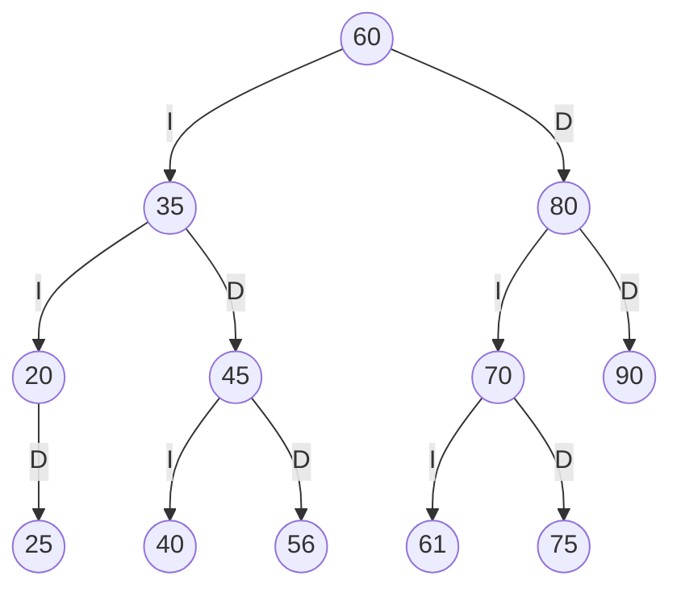
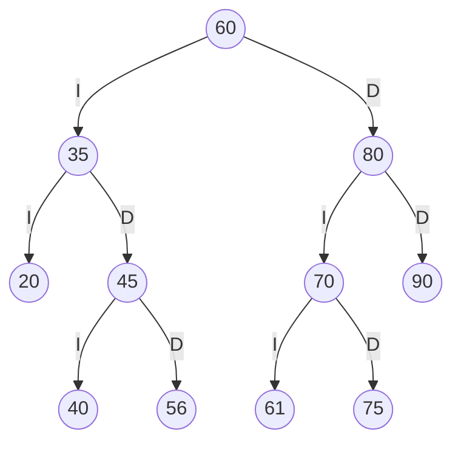
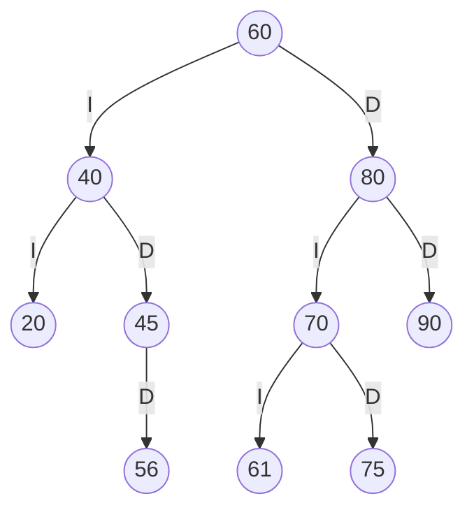
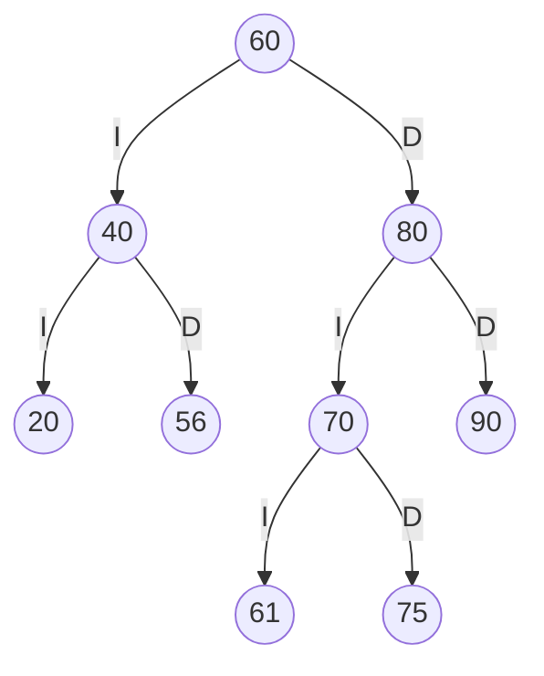
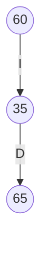
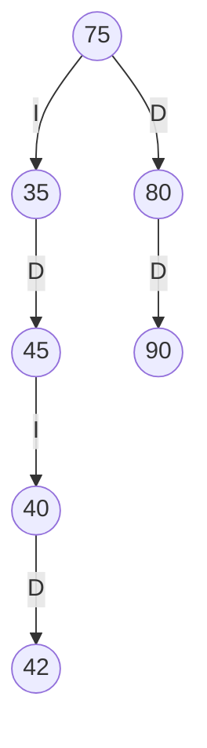

# TRAZAS del deber: Catálogo de la Biblioteca FISEI

Resolución a mano del ABB del estante SW-E1 con tres códigos personales, y comparación con la salida real del programa.

## 1. Códigos personales

Con los 4 últimos dígitos de la cédula (abcd = 2561) se forman ab, bc y cd. Si uno es 0, se repite o ya existe, se le suma 1.

| Código | Valor inicial | Valor final | Motivo |
|---|---|---|---|
| ab | 25 | 25 | sin cambios |
| bc | 56 | 56 | sin cambios |
| cd | 61 | 61 | sin cambios |

Códigos personales: **25, 56, 61**

## 2. Secuencia de inserción

Secuencia de SW-E1 seguida de los tres códigos personales: `60, 35, 80, 20, 45, 70, 90, 40, 75, 25, 56, 61`

| Paso | Código | Comparaciones desde la raíz | Posición |
|---|---|---|---|
| 1 | 60 | árbol vacío | raíz |
| 2 | 35 | 35 < 60 | izquierdo de 60 |
| 3 | 80 | 80 > 60 | derecho de 60 |
| 4 | 20 | 20 < 60, 20 < 35 | izquierdo de 35 |
| 5 | 45 | 45 < 60, 45 > 35 | derecho de 35 |
| 6 | 70 | 70 > 60, 70 < 80 | izquierdo de 80 |
| 7 | 90 | 90 > 60, 90 > 80 | derecho de 80 |
| 8 | 40 | 40 < 60, 40 > 35, 40 < 45 | izquierdo de 45 |
| 9 | 75 | 75 > 60, 75 < 80, 75 > 70 | derecho de 70 |
| 10 | 25 | 25 < 60, 25 < 35, 25 > 20 | derecho de 20 |
| 11 | 56 | 56 < 60, 56 > 35, 56 > 45 | derecho de 45 |
| 12 | 61 | 61 > 60, 61 < 80, 61 < 70 | izquierdo de 70 |

## 3. ABB final



## 4. Recorridos

| Recorrido | A mano | Programa | Coincide |
|---|---|---|---|
| Preorden | 60 35 20 25 45 40 56 80 70 61 75 90 | 60 35 20 25 45 40 56 80 70 61 75 90 | SI |
| Inorden | 20 25 35 40 45 56 60 61 70 75 80 90 | 20 25 35 40 45 56 60 61 70 75 80 90 | SI |
| Posorden | 25 20 40 56 45 35 61 75 70 90 80 60 | 25 20 40 56 45 35 61 75 70 90 80 60 | SI |

El inorden sale ordenado de menor a mayor, lo que confirma que el árbol cumple la regla del ABB.

## 5. Traza del preorden

Traza a mano:

```
entra 60
VISITA 60
  entra 35
  VISITA 35
    entra 20
    VISITA 20
      null -> regresa
      entra 25
      VISITA 25
        null -> regresa
        null -> regresa
    entra 45
    VISITA 45
      entra 40
      VISITA 40
        null -> regresa
        null -> regresa
      entra 56
      VISITA 56
        null -> regresa
        null -> regresa
  entra 80
  VISITA 80
    entra 70
    VISITA 70
      entra 61
      VISITA 61
        null -> regresa
        null -> regresa
      entra 75
      VISITA 75
        null -> regresa
        null -> regresa
    entra 90
    VISITA 90
      null -> regresa
      null -> regresa
Secuencia PREORDEN: 60 35 20 25 45 40 56 80 70 61 75 90
```

Salida del programa (`trazaRecorrido(PREORDEN)`): coincide = **SI**

## 6. Eliminaciones

Las tres eliminaciones se aplican en orden sobre el ABB final.

### 6.1 Eliminar 25 (hoja)

El nodo 25 no tiene hijos: se quita y su padre apunta a nulo.



| | A mano | Programa | Coincide |
|---|---|---|---|
| Preorden | 60 35 20 45 40 56 80 70 61 75 90 | 60 35 20 45 40 56 80 70 61 75 90 | SI |
| Inorden | 20 35 40 45 56 60 61 70 75 80 90 | 20 35 40 45 56 60 61 70 75 80 90 | SI |

### 6.2 Eliminar 35 (dos hijos)

El nodo 35 tiene dos hijos: se reemplaza su dato por el del sucesor inorden (el mínimo de su subárbol derecho) y se elimina el nodo del sucesor.



| | A mano | Programa | Coincide |
|---|---|---|---|
| Preorden | 60 40 20 45 56 80 70 61 75 90 | 60 40 20 45 56 80 70 61 75 90 | SI |
| Inorden | 20 40 45 56 60 61 70 75 80 90 | 20 40 45 56 60 61 70 75 80 90 | SI |

### 6.3 Eliminar 45 (un hijo)

El nodo 45 tiene un solo hijo: ese hijo ocupa su lugar.



| | A mano | Programa | Coincide |
|---|---|---|---|
| Preorden | 60 40 20 56 80 70 61 75 90 | 60 40 20 56 80 70 61 75 90 | SI |
| Inorden | 20 40 56 60 61 70 75 80 90 | 20 40 56 60 61 70 75 80 90 | SI |

## 7. Retos sobre SW-E1 (estante inicial)

### 7.1 `caminoBusqueda(42)`

- 42 < 60: visita 60 y baja por la izquierda.
- 42 > 35: visita 35 y baja por la derecha.
- 42 < 45: visita 45 y baja por la izquierda.
- 42 > 40: visita 40 y baja por la derecha, que es `null` (el código no existe).

A mano: `[60, 35, 45, 40]`. Programa: `[60, 35, 45, 40]`. Coincide: **SI**

### 7.2 `contarEnRango(40, 75)`

- La raíz 60 está en el rango: cuenta 1 y explora ambos lados.
- El nodo 35 es menor que 40: se poda su subárbol izquierdo y solo se explora el derecho.
- El nodo 45 está en el rango: cuenta 1, y su hijo izquierdo 40 también cuenta 1.
- El nodo 80 es mayor que 75: se poda su subárbol derecho y solo se explora el izquierdo.
- El nodo 70 cuenta 1 y su hijo derecho 75 cuenta 1.

Códigos en rango: 40, 45, 60, 70 y 75. A mano: 5. Programa: 5. Coincide: **SI**

### 7.3 `esABBValido()` con un nodo mal ubicado

Se arma un árbol con raíz 60, hijo izquierdo 35 y, como hijo derecho de 35, el código 65.



El 65 es mayor que su padre 35, pero también es mayor que la raíz 60 y está en su subárbol izquierdo, así que viola el límite máximo heredado. El método recursivo que pasa mínimo y máximo hacia abajo lo detecta.

A mano: `false`. Programa: `false`. Coincide: **SI**. Sobre el SW-E1 original el programa devuelve `true`.

## 8. Inserción de un repetido y eliminaciones sobre SW-E1 inicial

Secuencia: `insertar(45)` repetido, `insertar(42)`, `eliminar(20)`, `eliminar(70)` y `eliminar(60)`.

| Paso | Operación | Caso | Preorden resultante (programa) | Coincide |
|---|---|---|---|---|
| 1 | `insertar(45)` | Rechazado: código repetido (`false`) | sin cambios | SI |
| 2 | `insertar(42)` | Hijo derecho de 40 | 60 35 20 45 40 42 80 70 75 90 | SI |
| 3 | `eliminar(20)` | Hoja: se desconecta de su padre 35 | 60 35 45 40 42 80 70 75 90 | SI |
| 4 | `eliminar(70)` | Un hijo: el 75 ocupa su lugar | 60 35 45 40 42 80 75 90 | SI |
| 5 | `eliminar(60)` | Dos hijos: el sucesor inorden es 75, el mínimo del subárbol derecho | 75 35 45 40 42 80 90 | SI |

Árbol final:



El programa confirma que sigue siendo un ABB válido (`esABBValido()` devuelve `true`).

## 9. Conclusión

La resolución a mano coincide con la salida del programa en recorridos, traza y eliminaciones.
