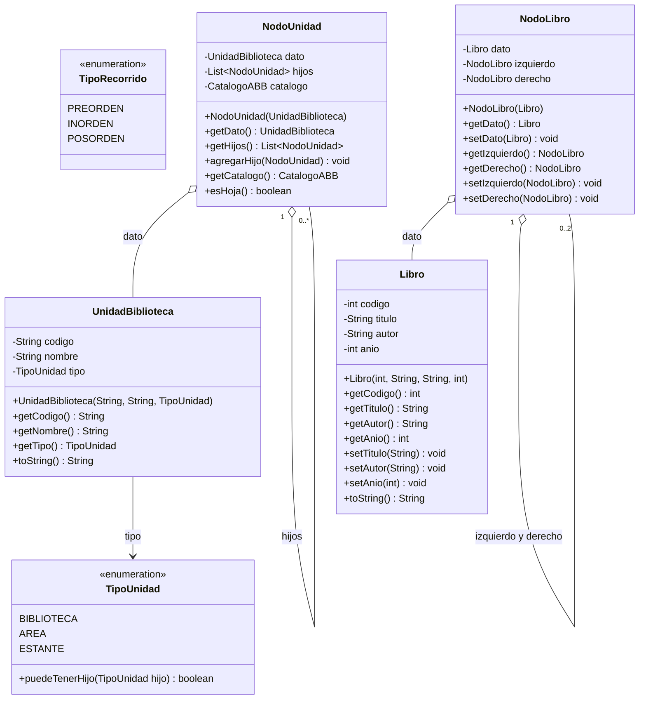
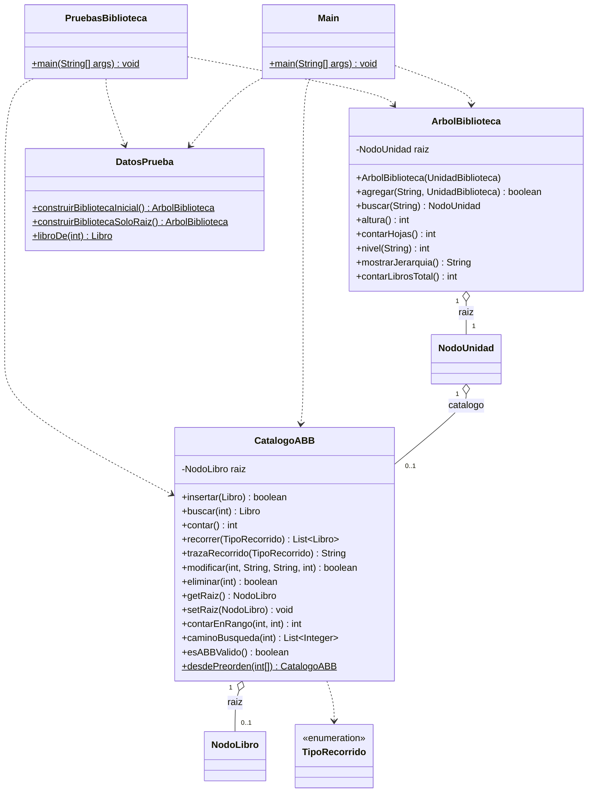
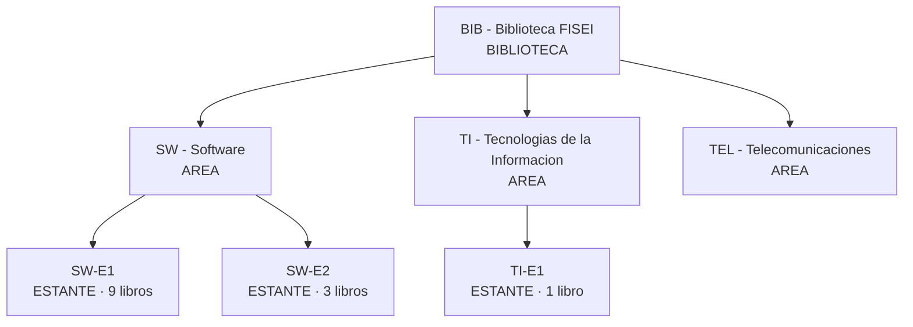
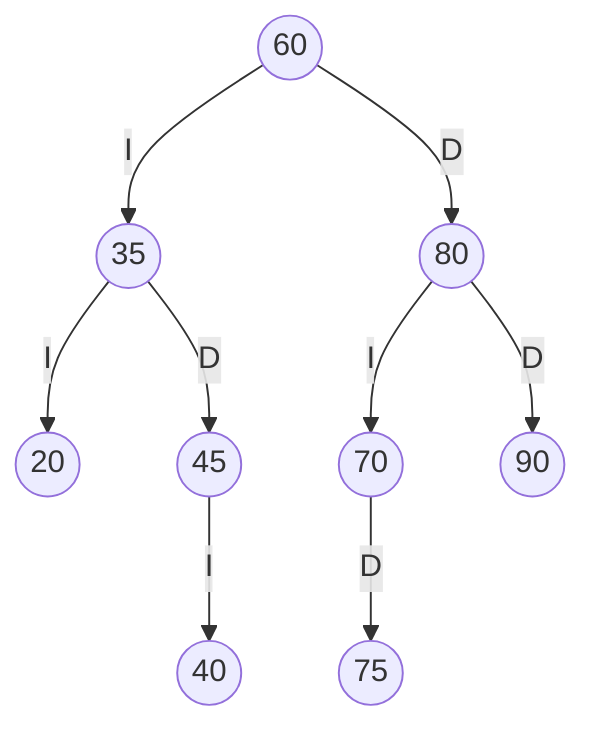
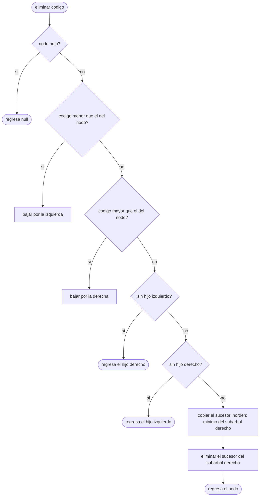
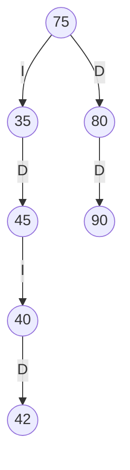

# Diagramas del proyecto

Diagramas del catálogo de la Biblioteca FISEI.

## 1. Diagrama de clases: enumeraciones, modelo y nodos

## 2. Diagrama de clases: lógica de negocio y aplicación

## 3. Árbol general de la biblioteca (estructura inicial)

La regla de la jerarquía es BIBLIOTECA → AREA → ESTANTE. Solo los nodos de tipo ESTANTE tienen un catálogo ABB.

Altura: 2 aristas. Hojas: 4 (SW-E1, SW-E2, TI-E1 y TEL). Libros en total: 13.

## 4. ABB del estante SW-E1

Códigos insertados en este orden: 60, 35, 80, 20, 45, 70, 90, 40, 75.

| Recorrido | Secuencia |
|---|---|
| Preorden | 60 35 20 45 40 80 70 75 90 |
| Inorden | 20 35 40 45 60 70 75 80 90 |
| Posorden | 20 40 45 35 75 70 90 80 60 |

## 5. Eliminación en el ABB

Los tres casos: hoja (ambos hijos nulos, entra por el caso de hijo izquierdo nulo), un solo hijo (el hijo ocupa el lugar) y dos hijos (se usa el sucesor inorden).

## 6. Estado del ABB de SW-E1 tras insertar 42 y eliminar 20, 70 y 60

Preorden esperado: 75 35 45 40 42 80 90.
